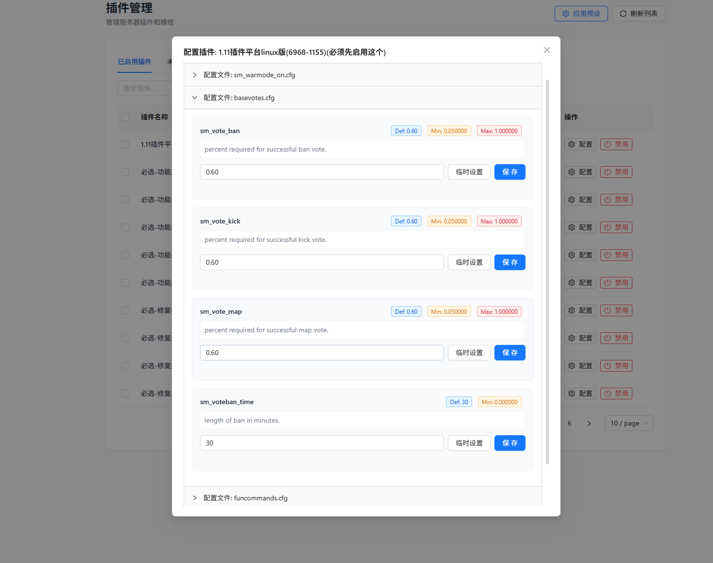
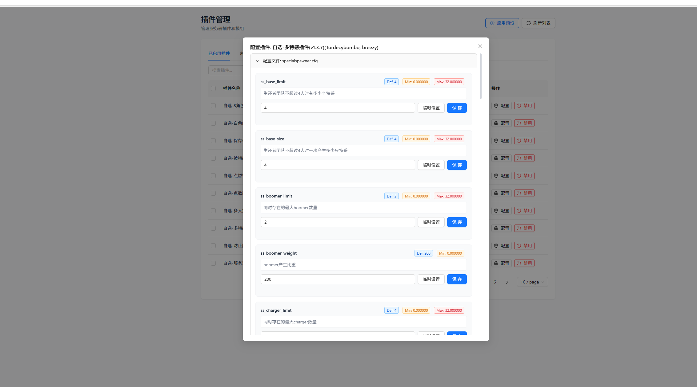

# 01: L4D2 插件配置缺少含义说明与多文件展示

Status: done
Type: enhancement
来源: 用户反馈（2026-10-19）

## 现象

L4D2 插件管理的配置弹窗目前有两类可用性问题：

1. **当前值缺少含义说明**：配置项只展示键名、默认值/范围与输入框，无法从界面理解这个配置代表什么、修改后会影响什么。
2. **配置文件无法完整支持多文件编辑**：一个插件可能包含多个 cfg 文件，但界面不能可靠地展示并按文件组织全部配置修改。

复现入口：

- 打开 `http://localhost:3002/extensions/app/l4d2/plugins?instanceId=97`
- 点击「1.11插件平台linux版」的配置
- 点击「自选-多特感插件(v1.3.7)(Tordecybombo, breezy)」的配置

## 期望

参考 `assets/` 下两张截图：

- 一个配置弹窗内按配置文件折叠/分组，例如 `sm_warmode_on.cfg`、`basevotes.cfg`、`funcommands.cfg`。
- 每个配置项展示默认值、最小值/最大值（有则展示）、说明文字、当前值，以及「临时设置」「保存」等操作。
- 多个 cfg 文件都能在同一弹窗中展开、查看和编辑，不因文件数量或文件切换而丢配置。





## 验收

- [x] 含说明的配置项在界面上能看到可读说明。
- [x] 一个插件包含多个 cfg 文件时，全部文件可展开并分别查看配置。
- [x] 每个配置项仍能读取当前值，并支持预期的保存/临时设置操作。
- [x] 文件切换或折叠不会丢失未保存的输入状态。
- [x] 无说明或无范围的配置项有清晰降级展示，不空白、不错位。

## 关联

- 配置页入口：L4D2 插件管理页的配置弹窗。
- 术语遵循 `CONTEXT.md` 的 L4D2 插件配置相关领域词汇。
- 本 issue 已由 triage 转为可执行说明。

## Comments

> *This was generated by AI during triage.*

### 2026-10-20 Triage 结论

**分类：** enhancement
**状态：** ready-for-agent

说明文字链路已经存在：`SourceModCfgParser` 从 cfg 注释中解析 `description`、`defaultValue`、`min`、`max`，`ConfigItem` 承载这些字段，当前插件配置页已经渲染描述、默认值和范围。因此本票不需要重新设计元数据来源，主要缺口是“同一插件多个 cfg 文件”的完整读取与按文件写回。

真实安装的“1.11插件平台linux版”元数据包含三个配置文件：

```text
sm_warmode_off.cfg
sm_warmode_on.cfg
sourcemod.cfg
```

当前 `SourceModCfgService.getConfig()` 遍历候选路径并在第一个存在的文件处返回；响应 VO 只有单个 `configPath`；`PluginConfigUpdateDTO` 没有目标文件路径，`updateConfig()` 也会重新选择第一个存在的候选。前端因此只能看到并编辑一个文件，且无法安全地只保存当前文件。

## Agent Brief

**Category:** enhancement
**Summary:** 在同一插件配置弹窗中展示全部可编辑 cfg 文件，并按文件独立读写且保留未保存输入

**Current behavior:**

插件配置 API 返回单个 `configPath` 和一组 `items`。服务层读取第一个存在的候选 cfg，更新时再次推导并写回第一个存在的候选。插件元数据中的 `configFiles` 虽然可能包含多个文件，但后端响应、更新 DTO 和前端状态都没有文件维度，用户无法查看或保存其余 cfg。配置项说明、默认值与范围的解析和展示已经具备。

**Desired behavior:**

插件配置响应包含该插件的全部可编辑配置文件，每项至少有文件路径、显示名、配置项、识别状态和最后同步时间。空文件、读取失败、无配置项的文件应有清晰状态，不能因为其中一个文件失败而丢弃其他文件。

前端在同一页面中按文件分组或折叠展示；切换文件时保留每个文件尚未保存的输入。保存只写目标文件，不得因为文件顺序变化而误写另一个 cfg。临时应用仍按其当前文件的配置项工作；若某个文件不可临时应用，界面应禁用该操作并显示原因。未识别说明或范围的配置项继续使用当前降级展示。

为兼容旧的单文件调用方，保留单文件读取/更新能力，并让新增的文件维度成为显式契约；不要依赖“候选路径顺序”猜测目标文件。

**Key interfaces:**

- `PluginConfigVO`：当前只有单个 `configName`、`configPath`、`items`；应增加文件集合或改为带兼容字段的文件列表响应。
- `PluginConfigUpdateDTO`：当前只有 `instanceId`、`pluginName`、`items`；需要显式目标文件路径或稳定文件标识，并校验它属于该插件候选集合。
- `SourceModCfgService.getConfig()` / `updateConfig()`：当前只处理首个存在文件；应能枚举并分别解析、写回每个文件。
- `PluginConfigResource` / `PluginConfigSpec`：当前资源名和 spec 以插件为粒度；若持久化只支持一个快照，应明确多文件快照结构或按文件持久化，并处理旧数据迁移。
- `pluginConfigApi.get()` / `update()` 与插件配置页：需要文件维度状态和按文件保存。

**Acceptance criteria:**

- [x] 对 `configFiles` 含多个有效 cfg 的插件，响应返回全部文件，而不是只有第一个存在的文件。
- [x] 每个文件分别展示路径、配置项、当前值、默认值、范围和说明；缺字段时保持清晰降级。
- [x] 修改文件 A 后切换到文件 B 再切回，文件 A 的未保存输入仍存在。
- [x] 在文件 B 点击保存只写入文件 B；文件 A 的内容不变，且响应路径与请求目标一致。
- [x] 文件读取失败或配置为空时，其他文件仍可查看和保存，失败文件显示可定位错误。
- [x] 请求更新的目标路径不在该插件候选文件集合内时被拒绝，防止路径穿越或跨插件写入。
- [x] 旧版单文件读取和更新调用仍可用，行为有回归测试。
- [x] 后端测试覆盖多文件解析、按文件写回、空文件和非法目标路径；前端测试覆盖分组展示、切换保留输入和按文件保存。

**Out of scope:**

- 改变 cfg 注释格式、说明文字来源或重新设计 SourceMod 配置项语义。
- 支持非 cfg 文件编辑。
- 自动解决同一 CVAR 跨多个文件定义时的业务冲突；当前只需保留文件边界，不擅自合并值。
- 修改 RCON 临时应用的安全策略或 CVAR 黑名单。

### 2026-10-20 实施结果

**实现**

- 配置响应增加文件维度，逐文件返回稳定 `fileId`、路径、状态、配置项和最后同步时间。
- 保存、恢复默认值按显式 `fileId` / 完整路径定位，拒绝路径穿越、未声明目标和有歧义的 basename。
- 前端按文件折叠分组；每项提供临时设置按钮，无法执行时禁用并显示原因；切换插件时防止旧请求覆盖新选择。
- 文件名推导回退只在没有有效 meta 声明时使用；同名不同目录分别保留。

**验证**

- 插件前端测试：7 个文件、42/42 通过。
- `vue-tsc --noEmit` 与 `npm run build` 通过。
- 后端定向测试通过：`SourceModCfgServiceTest`、`SourceModCfgServiceCandidatesTest`、`PluginConfigControllerTest`。
- 实例 97 的“1.11插件平台linux版”返回 3 个独立文件；`specialspawner.cfg` 返回 30 项，28 项有范围。
- 真实 Playwright 用例通过：多文件展示、范围解析、元数据不泄漏、折叠草稿保留。
- 插件 JAR 热部署后状态 `STARTED`，后端 PID 35216 未变化。
